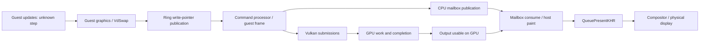

# 013 — Frame freezes, catch-up movement and close-up performance

## Executive summary

The current symptom is **loss of smooth, fresh hockey motion and responsive action timing**, especially bench shots and player close-ups. It is not simply low average FPS, a proven slow game clock, or the historical ten-second slideshows, which are no longer occurring recently.

The strongest defensible explanation is **intermittent delivery of fresh animation-bearing output**: guest work, rendering/completion or presentation can pause, then expose newer game state in a jump. The source confirms mechanisms at all three boundaries, but present data cannot choose the responsible boundary or prove that the simulation itself catches up. Wide-angle freezes and severe close-up stop-motion may have different causes.

The useful next diagnostic is a **bounded frame-lineage and progress trace**, without MangoHud: guest swap requests/command-ring progress → command-processor frame and submission IDs → GPU output-completion observation → mailbox output generation consumed → host present. Include wait-duration reasons and scene markers, with bench/close-up segments prioritized against wide-angle play and introductions. Existing counters alone do not connect these stages. A small isolated **instrumented application/SDK build and restart are required** to add that connection; nothing is implemented or executed here. The current installed game can remain untouched.

Even this diagnostic cannot prove unique pixels or identify an unavailable NHL simulation-step function. It can separate command-generation, GPU/submission and presentation/freshness failures when the recorded evidence supports that classification, and must report ambiguous cases instead of inventing an answer.

## Scope, provenance and evidence rules

Repository/origin verified as `Grognlor/nhl-legacy-recomp`; branch `perf/ally-investigation`, initially clean, starting commit `c56cb2176f13540a9edb9189021745f8e4ff47c1`. Reviewed reports [005](005-simulation-vs-live-bottleneck-investigation.md), [007](007-cpu-codegen-optimization-audit.md), [009](009-mangohud-frametime-profiling-plan.md), [011](011-correlated-frametime-telemetry.md), [012](012-simulation-timing-and-synchronization.md), index, existing collector/importer/offline analyzer and relevant tracked renderer/SDK patches. SDK references are to pin **`bd9b51918faa71f962fa38af6d5f744af9aba2ce`** before applying title patches; patch additions shift SDK line numbers. No later SDK is substituted.

Labels: **S** = confirmed source; **M** = existing recording/offline measurement; **U** = user observation; **H** = causal hypothesis. Proposed diagnostic fields below are explicitly **new**, not claimed existing instrumentation. Generated NHL implementation and installed effective build/codegen settings remain unknown (reports 007/008).

Only this report and index change. No game/Steam interaction, build, instrumentation, timing/renderer change, launch option or system change occurred. Existing raw CSV was read in place for one supplementary offline calculation; no new gameplay data, images, hashes of rendered content, assets, executable contents, memory dumps or raw-data uploads were collected.

## New gameplay evidence and interpretation

[U] The new session was already running, uncapped, **without MangoHud**: Toronto–Chicago, CPU-versus-CPU, five-minute periods, VSync off, FSR Ultra Performance. Approximately 720p/1×, shadows off and nominal 25 W are inherited context, not freshly verified. No setting changed during this observation.

- **Introduction:** looked slow, but intentional cinematic pacing could not be distinguished from slowdown. Keep it as scenario A, not a confirmed simulation fault.
- **Wide-angle active hockey:** brief player freezes followed by sudden catch-up are the dominant disruption (scenario B).
- **Bench/player close-ups:** consistently much worse, frequently frozen and stop-motion-like (scenario C). This is the highest-priority scene comparison, not an incidental transition to discard.
- **Manual match clock:** 30 displayed seconds took ~4.62 s and ~5 s wall time, or **6.49 and 6.0 displayed seconds/s**. The wall-time difference is ~0.38 s (~8.2% longer), and rate difference ~7.6%, with unquantified human timing uncertainty. Exact clock-scaling rules are unverified; five-minute periods alone do not establish an expected ratio. Do not call this a significant slowdown or normal-speed proof.
- The broadly similar displayed-clock rate weakens the simple claim that the entire game clock slows drastically during every visible hitch. It says nothing conclusive about animation steps, input consumption, physics updates or repeated images. No timestamps tie these manual samples to report 011.

The old MangoHud 60 FPS regression remains a separate user-observed intervention. Report 012's queue-lock/limiter-sleep mechanism is source-supported, not a confirmed explanation of that intervention. **No limiter sleep is needed to explain the new uncapped/no-overlay symptoms; do not transfer that causal claim to this session.** FSR's modest benefit likewise is not a GPU-bound verdict; the SDK can resize an already-rendered output before temporal upscaling.

## Complete lifecycle and existing observability

The CPU mailbox publication and GPU completion are separate edges: publishing an output is not proof its GPU work is finished. Submission/semaphore ordering makes rendering possible later, not necessarily complete at publication time.

| Stage | Exact source/functions and raw line ranges | What exists now; what is not measured |
| --- | --- | --- |
| 1. Guest simulation/animation/input updates | `src/system/xthread.cpp`, `XThread::Execute`, **571–650**, calls generated guest functions. NHL native `src/nhllegacy_app.h` configures the runtime, not a verified replacement simulation loop. | Thread creation/start-address logging exists. No identified simulation/animation step counter or timestep policy in the inspected source. No arbitrary guest address is proposed for a hook. [R-thread], [N-app] |
| 2. Guest graphics generation | `VdSwap_entry`, `src/kernel/xboxkrnl/xboxkrnl_video.cpp`, **428–510**, writes fetch information plus `PM4_XE_SWAP` into a caller-provided 64-dword command block. | A hook boundary exists, not an existing per-call diagnostic ID or proof of simulation progress. Writing a packet is not publishing a command-buffer write pointer. [R-video] |
| 3. Ring publication/consumption | `CommandProcessor::UpdateWritePointer`, **404–407**; `WorkerThreadMain`, **274–323**, executes batches and writes read-pointer progress to guest memory. | Write/read indices and event signaling exist. They can expose command starvation/backpressure; wrapped ring indices are not unique frame IDs. [R-cp] |
| 4. CP swap and draws | `ExecutePacketType3_XE_SWAP`, **1067–1102**; `VulkanCommandProcessor::IssueDraw`, **3603 onward**; title `NhlVkCommandProcessor::IssueSwap`, **230–277**. | Optional `REXGLUE_ENABLE_PERF_COUNTERS` frame timing in packet execution; title `frames_total_`, `draws_this_frame_`, window timing and `[nhl-vk-fps]` log/perf snapshot. These count CP swaps/draws, not unique images or simulation steps. [R-cp], [R-vk], [N-vk] |
| 5. Vulkan recording/submission | `BeginSubmission`, **5127–5196**; `EndSubmission`, **5265–5494**, submits under queue acquisition, assigns submission sequence and closes frame slots. | `frame_current_`, `closed_frame_submissions_`, `GetCurrentSubmission()` and fence associations exist. One frame can have multiple submissions; a CPU successful submit is not GPU completion. [R-vk] |
| 6. GPU completion | `CheckSubmissionFenceAndDeviceLoss`, **4979–5050**, blocking or zero-timeout fence checks; `VulkanSubmissionTracker::UpdateAndGetCompletedSubmission`, **~65–89**, and `AwaitSubmissionCompletion`, **91–141**. | Completion indices/fences exist. Their host observation time can lag actual GPU completion, especially if the observing thread is blocked. No existing per-frame CPU/GPU calibrated timing stream was found in these paths. [R-vk], [R-tracker] |
| 7. Guest-output handoff | `VulkanCommandProcessor::IssueSwap`, **2285–2437**, refresh callback finishes at **2920–2943**; `VulkanPresenter::RefreshGuestOutputImpl`, **1013–1071**. | Refresh success, image allocation version and refresher-submission tracking exist. Refresh submits output operations before mailbox publication; successful callback does not prove completed pixels. [R-vk], [R-present] |
| 8. Mailbox | `Presenter::RefreshGuestOutput`, **553–650**, publishes latest ready slot; `ConsumeGuestOutput`, **807–855**, acquires latest slot with consumer synchronization. | Three reusable slots; pending output can be replaced. Consumer may receive the same slot/output again. No existing per-refresh lineage ID distinguishes those cases. [R-presenter] |
| 9. Host painting | `PaintFromUIThread`, **422–518**, `GetDesiredPaintModeFromUIThread`, **1310–1333**; Vulkan `PaintAndPresentImpl`, **1497–1611**, consumes output, waits/acquires paint/swapchain resources. | UI or immediate guest-output/CP painting, depending on mode. UI requests can paint without a new guest output; no identified per-paint output sequence stream. [R-presenter], [R-present] |
| 10. Host present | Vulkan `PaintAndPresentImpl`, **2196–2210**, holds queue acquisition around `vkQueuePresentKHR`; `device.h`, **244–262**, defines queue mutex ownership. | Present call/result and semaphore/swapchain image are observable. Return is not physical display time or proof the image was scanned out. [R-present], [R-device] |
| 11. Frame timing | MangoHud v0.8.4 `overlay_QueuePresentKHR`, **1686–1764**; title swap timing above; existing `ally_profiler.py::analyze_csv`/`analyze_recording.py`. | Prior CSV validates presentation intervals and elapsed, not image identity or input/animation progress. Current session has no MangoHud. Physical refresh/scanout needs separate compositor/display evidence; this diagnostic does not claim to measure it. [M-vulkan] |

**Two identity traps:** CP `counter_` increments after swaps (`XE_SWAP`) **and** on `GraphicsSystem::MarkVblank` (**328–340**). Do not reuse it as a unique guest-frame counter. `GuestOutputImageInstance::version` is incremented on allocation/recreation (`RefreshGuestOutputImpl`, **1026–1044**), not every refresh. Nor is a recurring mailbox index a unique frame ID. [R-graphics], [R-present]

## Existing telemetry: what it adds and cannot decide

[M] Report 011 remains a different, older uncapped MangoHud-injected rendered match, with no scene tags or guest/submission/output identities. It cannot be relabelled as the new no-overlay session or as a bench shot capture.

Its **8,909 frames**, **74.34 mean presentation FPS**, **p95 26.03 ms**, **p99 35.75 ms**, **126 >33.33 ms**, **nine >50 ms**, **none >100 ms** are unchanged. Largest slow-frame cluster is **17.505–21.645 s**, 30 intervals >33.33 ms with at most one second between those slow samples; faster frames intervene. Worst full second was ~55 FPS; worst ten-second window ~67.5 FPS. These are presentation statistics, not skating/action rates.

A supplementary offline check of the exact same raw CSV found:

| Following-frame test | Result |
| --- | ---: |
| >33.33 ms frame followed immediately by <5 ms | **85/126 (67.46%)** |
| >33.33 ms frame followed immediately by <8.33 ms | **105/126 (83.33%)** |
| >33.33 ms frame followed immediately by <16.67 ms | **109/126 (86.51%)** |
| Median / mean next interval after >33.33 ms | **3.458 / 6.410 ms** |
| Overall frames <5 ms | **1,519/8,909 (17.05%)** |

For example, the **75.744 ms** interval ending at CSV elapsed **20.309060 s** is followed by **2.598, 5.448 and 6.533 ms** intervals. The long/short pattern supports uneven cadence or release of delayed work, not a measured animation catch-up. It may include UI repaints, reuse of output, buffered completion, guest burst generation or other patterns. The following intervals are not statistically independent; no causal significance test is claimed.

[M] Conditional filename-based alignment in report 011 has ~one-second uncertainty. Its poorer 17–22 s region has process CPU ~267% versus ~342% in smoother 40–50 s; command worker ~27% versus ~37%; TID 11838 `XThread020C` remains ~95% of one core. Fewer CPU cycles in peers could mean waiting, less work, scene changes or lack of progress, not spare critical-path capacity. Context-switch counts do not identify lock owners or wait duration. Four named pipeline workers accumulated zero ticks, weakening sustained compilation **on those workers in that warm interval**, not all driver/intro compilation. Invalid GPU utilization is excluded; clock/power were not shown to collapse persistently.

**No existing recording distinguishes guest starvation, GPU completion stalls, repeated mailbox output and physical display repetition.** In particular, a burst of short present intervals after a long one proves neither queued unique images nor recovered simulation steps.

## Freeze/catch-up mechanisms and scene dependence

“Catch-up” below means a possible visual result of newer state arriving after a pause, not a verified fixed-step catch-up algorithm. Each mechanism can affect action timing through irregular state visibility; actual input-consumption latency remains unmeasured.

| Candidate and source | Confirmed mechanism; possible freeze/catch-up and responsiveness effects | Bench/close-up relation; evidence against overclaiming | Discriminating measurement |
| --- | --- | --- | --- |
| Guest update/synchronization stall — `XThread::Execute/Delay` **571–650/1000–1038**; kernel spinlock **967–980**; dispatcher interrupt **130–160** | Guest work may block/yield/spin. If animation-bearing work pauses, later state can jump. The inspected code does not reveal NHL's animation/delta policy. | More character/camera/animation work is plausible, not identified. Similar match-clock rate does not exclude another subsystem stalling; hot thread is not mapped. | Guest swap-entry/exit and ring publication gaps with no queued work, plus wait phases and thread telemetry. If all graphics progress continues, true simulation/animation attribution still needs an independently identified update hook. |
| CP/ring backpressure — CP worker **274–323**, `WAIT_REG_MEM` **1116–1190** | Worker may wait for guest memory/registers or block while processing packets; guest-visible read pointer advances only afterward. Queued work/guest generation can pause and resume in bursts. | Existing lower worker activity is compatible but nonspecific. Scene-related command/resource pressure could amplify it; no measured queue occupancy. | Ring publish/read deltas and wrap-safe epochs, active CP wait phase, G→C timing where uniquely matched. |
| Queue/fence/semaphore/submission wait — Vulkan **4979–5050/5127–5153/5438–5454**; presenter **1497–1541/2196–2210** | Queue mutex, finite frame/paint resources, image acquisition or GPU completion can block the pipeline. Ready/new states arriving later may jump. Normal uncapped present can block too. | Close-up-specific resource/queue demands possible. No-overlay freezes cannot be directly blamed on MangoHud limiter sleep; actual queue sharing is unmeasured. | Queue-lock acquisition/API spans, pending submissions, independent nonblocking GPU-output completion probe, paint/acquire spans. |
| Retained full readback / memexport — app **200–219**, title patch **357–425**; Vulkan resolve **4416–4705**, memexport **4200–4340** | Full resolve path drains GPU, invalidates/copies into guest RAM; memexport paths also may wait. Existing >3 MB gate does not eliminate all reads. CPU/GPU dependent work can resume unevenly. | Equipment/player texture compositing is a concrete NHL use, but close-ups are not proven to trigger more readbacks. Gate correctness comments are historical, not scene telemetry. | Per-output kept/skipped readback counts/bytes, total/max CPU wait, submission association; no buffer contents or policy change. |
| Other synchronous GPU work: occlusion query — `EndGuestOcclusionQuery` **4875–4920** | If enabled/used, query result copy has WAIT flag, submits and awaits all queue completion. This is existing behavior, not proposed instrumentation. | Possible additional scene/state-dependent synchronization, but effective enablement and NHL usage unverified; do not rank it as a found bottleneck. | Count actual query calls and attributable existing wait time; leave setting unchanged. |
| Texture creation/upload and pipeline work — texture **549–555/1212–1740**; pipeline **1013–1048/3009–3495/3520–3561** | Resource conversion/barriers and pipeline creation can extend CP/GPU work; new state after a gap can appear as catch-up. | New camera/bench textures, states or LOD are plausible; close-ups may have fewer polygons. Warm pipeline-worker inactivity contradicts assuming continuous compilation everywhere. | Aggregate create/upload bytes/time and PSO misses/creation spans by output/scene; GPU completion lag. No resource/shader dump. |
| Mailbox/UI/output freshness — presenter **553–650/807–855/422–518/1310–1333** | Producer replaces pending image; consumer may reuse acquired output. New state after repeated outputs or skipped generations can look like a jump while presents stay high. | All scenes use this architecture; why C is worse requires measured upstream work or paint behavior. Existing 74 FPS/short bursts fit but do not prove this. | Unique refresh-generation → consume → present mapping, repeat age and overwritten-before-consume counts with dropped-trace accounting. |
| Vblank and timing — graphics **153–180/306–340**, clock **66–89/158–175** | Independent guest clock and VSync-off nominal 1 ms vblank callback cadence; interrupt dispatch holds a global critical region. Timing and lock dependencies could affect progress. | No actual callback/lock-cost measurement. Match clock similarity argues against guessing a broad clock-scalar fix. No identified intro/bench timestep. | Aggregate vblank/interrupt count/duration with guest/CP progress, not per-interrupt text logging; do not alter cadence. |

[S/H] Bench shots may change texture residency, equipment composites, render targets, character visibility, pixel coverage, animation/camera work and pipeline states. Some changes can be cheaper than wide-angle play; do not infer higher polygon count. Persistent severe close-ups after warming are a reason to examine recurring work/handoffs, not automatically cache misses. FSR Ultra Performance may only reduce present-upscaler input, leaving guest draws/readbacks intact (report 012). All sources in the table are renderer/runtime-level; **no verified source label maps a specific bench camera to one of them**.

Treat scenes separately:

- **A — introduction:** potential initial/transition workload; cinematic timing remains ambiguous. Record milestones/motion, not a match-clock slowdown claim.
- **B — wide-angle active play:** reference for intermittent freezes and action timing; clock delta is usable only during continuous play and with scaling caveats.
- **C — bench/player close-up:** highest priority; seek multiple naturally occurring examples and preserve the frequent-freeze characteristic. Match clock may intentionally stop; compare output freshness and motion instead.

## Ranked hypotheses and diagnostic value

1. **Intermittent render/CP completion or handoff blocking, producing stale output then a jump.** Source has real synchronous dependencies; old lower worker activity and new freeze/catch-up fit. It can leave a wall-derived match clock broadly normal. Equipment/resource work offers a concrete close-up lead, but no scene-tagged wait cost proves it. First measurement: where the new-output lineage stops, with wait/completion evidence.
2. **Presentation consumes repeated/latest-only outputs or runs late relative to newly completed output.** Mailbox reuse/replacement is confirmed architecture and can reconcile high FPS with jerky motion. It may be downstream of hypothesis 1 rather than independent. No recorded identities prove repeats/drops; scene specificity remains unexplained until measured.
3. **Guest command generation or animation/update work intermittently pauses while clock/UI progress continues.** Clock readings do not exclude it, but the hot thread's function and NHL update loop are unknown. If fresh GPU-completed outputs keep arriving and are consumed promptly during frozen animation, shift attention upstream to frame content/update work; do not mislabel new refreshes as new animation poses.
4. **Resource first use/pipeline creation, particular draw/pixel/bandwidth load or scheduling contention.** Available mechanisms and FSR/scene observations justify measuring them, not declaring GPU saturation. Warm-worker data weakens one compilation scenario. New uncapped/no-overlay symptoms may differ from the capped regression.

Thermal/power collapse and a wrong global time scalar remain unsupported. The ranking is not a probability estimate, and more than one cause may coexist.

## Proposed minimum diagnostic — design only

### Scope and minimum claim

Design an opt-in **90-second, metadata-only boundary trace** in a separately built executable and matching SDK, default disabled. No MangoHud is needed: record host present entry/return directly, avoiding overlay/limiter injection. Reuse existing counters/fences where possible, add only the identity/progress edges missing below, and bounded nonblocking GPU-output/paint probes so a stalled CP does not masquerade as a stalled GPU observer.

This distinguishes **guest command-generation availability**, **GPU/submission/synchronization progress**, and **CPU presentation/producer-output freshness**, including mixed failures. It does not magically instrument NHL's unlocated simulation loop. If these edges all advance but animation freezes, report **“upstream animation/content/input or downstream display unresolved”**, not a proven simulation stall. True simulation steps and unique pixel content are outside the minimum trace. This limitation is preferable to adding speculative generated-code hooks or intrusive image readbacks.

### Identity rules: all names below are proposed, not existing

- `session_id`: random per diagnostic run; IDs never compared across sessions.
- `G`: guest swap request ordinal, assigned at `VdSwap_entry` entry; record exit/success separately. It says the guest reached graphics presentation code, not that simulation advanced or the packet was committed.
- `W`: command write-pointer publication serial; carry ring epoch and read/write positions to distinguish wrap. Aggregate publication count rather than dumping PM4 words.
- `C`: CP `XE_SWAP` entry ordinal; record its exit separately, including failure/skip outcome. Do not reuse `counter_`.
- `F`: CP frame-recording lifetime, based on actual first guest `BeginSubmission` opening and actual `frame_open_` close, linked to C when encountered. Do not increment on every `EndSubmission(true)` call: `IssueSwap` can call that helper twice, including an inert final close.
- `S`: successful Vulkan submission sequence, scoped by queue and epoch; link submission range to F and distinguish guest render, output refresh, paint and auxiliary submissions. Log attempted/failed submits separately.
- `R`: monotonically increasing **successful guest-output refresh generation**, assigned to the writable mailbox slot before its release publication, with F/C and last render/output S. Failed/inactive/skipped refreshes have explicit outcomes and no invented successful R.
- `P`: host paint/present attempt ordinal, with actual consumed R, mailbox slot/allocation version, source F/C/S, present mode, swapchain epoch and result. A present attempt may be blank or unsuccessful; separate attempted from accepted.

A G→C mapping is only exact if a safe side-table match of the existing swap packet's location and reuse generation is available: observe the host-known packet storage key and CP reader position without changing guest packet bytes, and avoid exporting raw memory contents. Concurrent producers, indirect buffers and recycled locations must be handled explicitly. Assign a session-local opaque key, bounded entries and unmatched/ambiguous flags; **do not assume ordinal equality or FIFO correspondence merely because counts match**. If this optional exact match cannot be verified, separate G/W/C rates still localize starvation/backlog, and G→C latency remains Unknown. R→P must be exact within the trace or the diagnostic is incomplete.

### Concrete event and counter plan

Use the existing source locations from the lifecycle map; additional files are named explicitly here. Emit small numeric events to preallocated per-producer buffers, never synchronous text writes from rendering/guest threads.

| Proposed events/counters | Source/function to instrument | Producer / meaning |
| --- | --- | --- |
| `guest_swap_enter/exit(G,outcome)`, `ring_publish(W)`, sampled read/write epochs | SDK `VdSwap_entry`, **428–510**; `CommandProcessor::UpdateWritePointer`, **404–407**, worker **274–323** | Calling guest host thread and CP; independent generation/publication/consumption progress. Also record current native thread ID, not a guessed game subsystem. |
| `cp_swap_enter/exit(C,F)`, `frame_open/close(F)`, draw totals | `ExecutePacketType3_XE_SWAP`, **1067–1102**; Vulkan `BeginSubmission`/`EndSubmission`, **5127–5196/5265–5494**; title `IssueSwap` **230–277**, `IssueDraw` forwarding | CP. Reuse frame/draw counts as aggregates; no per-draw record spam. Persistent `active_phase` explains an unfinished long span. |
| `queue_acquire_begin/end(queue,reason)`, `submit_enter/exit(S,F,result)`, `fence_wait_begin/end(S)` | CP `EndSubmission` **5438–5475**, `CheckSubmissionFenceAndDeviceLoss` **4979–5050**; presenter `RefreshGuestOutputImpl` **1058–1070**, paint submit/present **~2160–2210** | Actual submitting/painting thread. Measure lock acquisition separately from submit/present call duration; do not add a lock or move existing locks. CPU wall durations only. |
| `readback_count/bytes/wait_total/max`, `occlusion_wait_total`, upload/create/PSO summaries | Vulkan readback helpers **4200–4340/4416–4705**, occlusion **4875–4920**; texture **1212–1740**, pipeline `ConfigurePipeline/EnsurePipelineCreated/CreationThread` **1048/3009–3495/3520–3561** | CP and existing pipeline workers. Aggregate by F/100 ms; counters include kept/skipped reads and query use. No buffer data, texture names or shader contents. Instrument existing wait boundaries; do not change policy. |
| `output_publish(R,F,C,S,slot)`, `output_consume(P,R,slot)` | `Presenter::RefreshGuestOutput` **553–650**, `ConsumeGuestOutput` **807–855**; `include/rex/ui/presenter.h` and Vulkan `GuestOutputImageInstance` in `include/rex/ui/vulkan/presenter.h` for sidecar metadata | Producer CP and actual consumer. Store R under the **existing mailbox ownership/release-acquire protocol**, read R while the consumer mutex protects the acquired slot. No additional blocking producer-consumer lock. |
| `paint_enter/exit(P,mode,R)`, `acquire_image_begin/end`, `present_enter/exit(P,R,result)` | generic UI/direct paint sites **422–518/623–640**, Vulkan `PaintAndPresentImpl` **1497–1541/1598–1611/2196–2210** | UI or immediate-output thread; identify actual role, not assumed UI-only. Carry R copied at consume through the entire paint; never re-read the latest mailbox later to label an old present. |
| `completion_observed(S)`; `gpu_output_end_available(R,F,S)`, `gpu_paint_end_available(P,R,S)` | Existing CP fence checks and `src/ui/vulkan/vulkan_submission_tracker.cpp`, `UpdateAndGetCompletedSubmission/AwaitSubmissionCompletion`, **~65–141**; new end-marker probe described below | Existing fence-owner thread plus a dedicated bounded observer. Existing completion counters are CPU observations, not device timestamps. |
| `vblank_count`, `interrupt_count/time_total/max`, heartbeat/active phases and dropped events | graphics `MarkVblank` **328–340**, dispatcher `ExecuteInterrupt` **130–160** | Timer/interrupt thread aggregates, not a text event for every nominal 1 ms callback. Observer/writer samples summaries every 100 ms. No catch-up/lock behavior changes. |

Every fixed-size event includes `qpc_ticks`, producer ID, local event sequence, type and a type-specific numeric payload with only the relevant IDs/result enums (not all IDs in every record). Metadata maps each producer to native thread ID; bounded link records carry longer associations. Use Windows **QueryPerformanceCounter and its frequency consistently** in this Windows/Proton process; do not use `QueryGuestTickCount` as the trace clock. Record paired QPC-before/UTC/QPC-after brackets at capture start/end and periodically on the observer to check drift/clock steps. All in-process events share that CPU clock. External collector Python monotonic epochs are not assumed identical; pair via UTC brackets and retain measured uncertainty, or omit sub-frame cross-correlation. No new hot-path IPC is required.

Scene tags A/B/C and freeze start/end are manually noted against host time by an observer and associated offline, including reaction/bracketing uncertainty. Label C as bench versus individual close-up where known. Do not infer scenes from draw counts or GPU addresses. If an optional numeric marker channel is later added, only the diagnostic writer handles it; no focus-stealing UI or unverified hotkey. Prioritize multiple C segments (~10–20 s each where naturally available), comparable B segments, and A introduction milestones; 90 s may require separate bounded recordings rather than altering game camera settings to force all scenes into one run.

### Fresh output versus identical pixels

The sidecar R is the smallest essential freshness measurement. Repeated **accepted** P carrying the same R proves repeated producer output generation, not why it repeated. A ready R replaced before any consume is a producer-side skipped output; a consumed R with no accepted present is a different outcome. Reconstruct these from the full event stream, never just differences in numeric IDs: incomplete events or trace drops invalidate exact skipped/repeat counts.

A new R is **not proof of a different animation pose or different pixel values**. Likewise `image_version` and mailbox slot reuse must not be used to assert repeats. Pixel equality, scanout drops and game-step progression cannot be conclusively measured by these metadata IDs. Do not add image readback, framebuffer hashing or screenshots: they could add the exact synchronization being investigated and are unnecessary to locate boundary progress. If fresh/completed/presented R continues while motion freezes, a later source-identified animation/update probe or separately scoped display observation is needed.

### GPU completion: minimum independent observation, no added waits

Existing fence-owner observations are useful but insufficient alone: if that CPU thread stops polling, `submission_completed_` can appear stalled after the GPU has finished. Do not poll its reusable fences from an unsynchronized helper; reset/recycle races could make the trace unsafe.

Propose **one end-of-guest-output device timestamp per R** in the already ordered command stream, after output operations/release barrier, before that work's existing `EndSubmission(true)` in the swap refresh callback (**~2920–2937**). Use a dedicated timestamp query pool with **8,192 never-reused R slots and 8,192 never-reused P slots per bounded capture** (16,384 total). Allocate in setup; reset slots before use through legal startup ordering and enable observation only after that reset is known complete via existing completion tracking. If no such initialization path can be integrated safely, GPU probing remains unavailable; do not query uninitialized slots or introduce a blocking reset wait. No new submission or queue-idle operation for each marker. If needed, the ordered encoder must add a timestamp command in `include/rex/graphics/vulkan/deferred_command_buffer.h` / `src/graphics/vulkan/deferred_command_buffer.cpp`; do not call a raw timestamp function out of order while commands are still deferred.

Also insert **one paint-end timestamp per P**, after all FSR/UI/guest-image painting and outside the render pass, before `vkEndCommandBuffer(draw_command_buffer)` in `VulkanPresenter::PaintAndPresentImpl` (**~2110–2122**). This closes a necessary gap: R can be complete while expensive postprocessing or paint GPU work still blocks display. Associate it with that paint's consumed R and successful paint submission, not merely the guest submission. These are two completion boundaries, not full per-pass profiling.

A dedicated observer checks published, successfully submitted slots with `vkGetQueryPoolResults`, **64-bit plus availability, without WAIT or PARTIAL**, at nominal 5 ms intervals, at most 64 pending slots per tick. Slots are published only after successful submission; never query uninitialized slots, never reset/reuse them during capture, and never recycle the pool while GPU/observer references remain. Include fairness across pending IDs and last-checked times. On capacity exhaustion stop adding probes and mark missing coverage; do not wait for space or throttle the game. Supported queue `timestampValidBits`, device `timestampPeriod`, stage support, wraparound and deferred command ordering are preflight requirements; absent support yields Unknown GPU completion, not zero time. [V-query], [V-timestamp], [V-family]

Use a supported end-of-pipeline stage outside render-pass/multiview ambiguity. Timestamp operations themselves impose execution dependencies and have nonzero GPU cost; they are **not claimed perturbation-free**. The two end markers are deliberately less than a full pass-profiler; they establish guest-output and paint-end progression/availability, not per-frame GPU busy time. [V-timestamp]

Record query-check CPU begin/end and result/availability. Completion is bracketed conservatively between the previous not-ready check's start and first ready check's end (or submit-call entry if no previous check). Five milliseconds is a requested poll period, not guaranteed precision; observer scheduling/driver call duration widens the bound. Device stamps remain in a separate clock domain: do not subtract them from QPC without a separately validated calibration. GPU work can finish before `vkQueueSubmit` returns, so submit-return time is not a completion lower bound. Timestamp deltas can describe ordered device output-end intervals after wrap handling, not active execution duration or utilization.

Query readiness cannot establish physical display completion. No extra completion fence, `vkQueueWaitIdle`, blocking result read, staging-image transfer or change to existing readback/synchronization policy is introduced by the proposed measurement. Any future implementation must pass lifetime/order tests before use. If this independent probe is deferred, the CPU/identity trace is a useful first tier, but GPU-complete versus observer-stalled cases remain explicitly unresolved; do not claim full A/B/C attribution from that tier alone.

### Overhead, sampling, output and safety budgets

Design limits, not measured overhead promises:

- One record per boundary, not per instruction/PM4 word/draw/pixel. Fast draw/upload/wait work aggregates by frame or 100 ms; record slow span summaries plus producer `active_phase` so an ongoing block is visible even before its exit event.
- No per-frame file flush or logging allocation. Preallocate a **16 MiB total event pool**, at most **32 producer buffers**, fixed **64-byte numeric records**; a separate writer drains without taking render/queue locks. Registration/capacity failure increments a dropped-event counter, never blocks a producer. Max diagnostic duration **90 s**.
- Output: `trace.bin` with versioned record schema/QPC frequency and enums; `metadata.json` (max 64 KiB) with code/SDK revision, effective flags, clock brackets, queue families/mode and capability/error/drop summaries; manual numeric scene notes (max 64 KiB). **Hard total ≤17 MiB per capture**; headers, counters and completion metadata count against that budget. At most 262,144 event records; file/buffer saturation marks incomplete coverage and disables recording, not game execution.
- Output location: a unique, exclusive external directory under canonical `~/nhl-ally-profiles/`, prepared by the existing trusted-home/output safety model. A Windows diagnostic must use an explicitly verified host-path mapping under Proton, not default to its working directory, installation or prefix. If mapping/permissions cannot be established, disable output and stop diagnostic setup; no fallback writes elsewhere.
- Expected work is a few timestamps/metadata operations at boundaries plus one GPU marker/R and one marker/P, observer queries and existing passive sampling. Exact CPU/GPU/driver overhead is **unknown**; compare instrumented-build logging-disabled versus enabled behavior before interpreting results. If that comparison itself materially changes freeze character, reduce probes or stop. Never promise a sub-percent overhead or silently sample away all short freezes.
- Keep all runtime options unchanged: no external cap, no MangoHud required, no VSync/FSR/readback/cache/affinity/priority changes. Do not enable broad verbose logs, GPU trace capture, resource inventory or proprietary asset exports.

## Expected interpretations and limits

| Observed trace during a marked freeze | Supported boundary diagnosis | What is not proven |
| --- | --- | --- |
| G/W flat, no pending command work; GPU outputs complete, presents repeat old R | Guest graphics-generation starvation (A boundary) | Does not identify simulation, animation, scheduling or lock site; a blocked earlier guest call can have downstream cause. |
| G/W advance, pending ring work grows, C/F pauses with queue/fence/readback active | CP/submission/synchronization bottleneck (B); upstream may subsequently backpressure | High hot-thread CPU is not proof it caused the stall; inspect first blocking span, not last stalled counter. |
| Submits succeed, pending R end markers stay unavailable while independent observer remains alive | GPU output completion/synchronization progress delayed (B) | Not uniquely expensive shaders: semaphore waits, dependencies, bandwidth or device scheduling can all delay completion. |
| R output completions advance; consumes/presents stop or lag; long CPU paint/acquire/present spans | Presentation-side scheduling/backpressure (C) | Does not establish the compositor's display time or which image was physically shown. |
| Guest R completes, paint-end probe remains unavailable after successful paint submission | Postprocessing/paint GPU work or its synchronization is delayed (B), even if present calls continue | Not a physical-display measurement or proof that the guest simulation stopped. |
| Accepted present rate stays high while same R repeats; later R jumps | Output reuse/replacement consistent with visible freeze/catch-up (C symptom) | Locate whether new R stopped upstream or finished R went unconsumed before assigning root cause. |
| New R and its paint complete and are promptly consumed/presented throughout frozen movement | No detected boundary-progress collapse; investigate animation/content/input or actual display | New R does not prove new pixels; this result cannot alone prove a guest simulation bug. |
| Trace drops, query pool unsupported/exhausted, or observer absent | Coverage insufficient; retain Unknown | Never classify unavailable observations as a stalled GPU or lost game frame. |

Use per-scene distributions of inter-G/C/R/completed-R/P intervals, repeat age, unmatched/overwritten counts and wait totals/maxima. The most valuable measurement is **completed fresh-output R reaching each present, with separate paint completion**, with upstream generation/submission lineage and explicit wait spans explaining where freshness stopped. Scene-tagged draw/upload/readback summaries then test why C differs from B; aggregate FPS is secondary.

## Deployment feasibility, rollback and next action

**Cannot obtain these identities/probes from the currently running unmodified game without a restart.** Passive `/proc` telemetry can describe thread time, but cannot create missing G/R/P events, recover earlier output identity or inject a new Vulkan layer retrospectively. Do not attach/patch the process. Existing title fps/draw logs, if available in a future authorized log scope, are useful coarse context but do not supply this lineage or independent completion.

A matching **instrumented Windows application and SDK rebuild**, with the required producer-generated sources/build environment, is needed. Rebuilding only the Python profiler or changing an environment variable does not add the missing events. The local repository still lacks verified generated producer artifacts; do not regenerate/build/access assets to bypass that limitation. First agree the minimal patch and authorized build producer/environment in a later task. Generated guest optimization/timing/ABI settings and `PPCContext` layout must remain unchanged; lineage is held in host-side sidecars, not guest register state; no speculative guest-step hook is part of the patch.

The current playable installation can remain untouched: build/stage separate diagnostic artifacts outside it, preserving the original executable/SDK and current shortcut/prefix/configuration. Launch-route and any use of the existing prefix require separate explicit agreement; do not promise isolation or create a new prefix automatically. No launch command or replacement installer is supplied.

Rollback for a future approved test: capture ends automatically after its bound; disable diagnostic output in that separate build. Existing GPU query resources must be retired only through normal safe lifetime handling after work is done, without adding a mid-test queue drain. Return to the original game through a separately approved normal exit/launch lifecycle; no original files/settings need restoration because none are changed. No automated termination, Steam restart, process patching or shortcut edit is designed.

**Recommended next action:** review/approve this bounded identity-plus-completion diagnostic design and establish a matching separate build producer before authorizing implementation. Bench/player close-ups must be the primary marked target, with wide-angle and introduction controls. This advances beyond report 012's game-clock audit because the new observations already show why clock slope alone is insufficient. Do not re-enable the 60 FPS cap or resume the obsolete slideshow reproduction plan.

## Remaining unknowns and validation

Unknown: exact guest animation/simulation/input update function and clock-scaling rule; pixel uniqueness and actual display timing; scene-tagged command/resource/readback costs; hot thread function; actual presenter mode/queue-family sharing; installed producer codegen/SDK settings; diagnostic GPU timestamp support/overhead and Windows-to-host output mapping. These remain conditions for implementation/test planning, not findings filled in by inference.

Validation: source/function/line and mailbox/submission identity checks against pinned public files and tracked title code; authoritative Vulkan query/timestamp semantics reviewed; source reference and local report links checked; report 011 raw input SHA-256 verified unchanged; long/short counts independently recomputed offline and checked with a small synthetic sequence; existing **32 synthetic tests pass**. Documentation diff/staged allowlist checked before commit. No new analyzer/instrumentation code or raw/derived telemetry artifact is added by this task. Only `reports/013-frame-freeze-and-catchup-investigation.md` and `reports/README.md` are committed/pushed to origin's investigation branch; master/upstream untouched. Stop after publication.

## Source references

SDK line ranges refer to the immutable pin, not post-patch line numbers. Source citations below are implementation evidence, not installed-binary execution evidence.

[M-vulkan]: https://github.com/flightlessmango/MangoHud/blob/v0.8.4/src/vulkan.cpp

[N-app]: https://github.com/Grognlor/nhl-legacy-recomp/blob/43e2ab95600dbb96fc2c8d073fb372861a649cba/src/nhllegacy_app.h

[N-vk]: https://github.com/Grognlor/nhl-legacy-recomp/blob/43e2ab95600dbb96fc2c8d073fb372861a649cba/renderer/core/nhl_vk_backend.cpp

[R-cp]: https://github.com/rexglue/rexglue-sdk/blob/bd9b51918faa71f962fa38af6d5f744af9aba2ce/src/graphics/command_processor.cpp

[R-device]: https://github.com/rexglue/rexglue-sdk/blob/bd9b51918faa71f962fa38af6d5f744af9aba2ce/include/rex/ui/vulkan/device.h

[R-graphics]: https://github.com/rexglue/rexglue-sdk/blob/bd9b51918faa71f962fa38af6d5f744af9aba2ce/src/graphics/graphics_system.cpp

[R-present]: https://github.com/rexglue/rexglue-sdk/blob/bd9b51918faa71f962fa38af6d5f744af9aba2ce/src/ui/vulkan/vulkan_presenter.cpp

[R-presenter]: https://github.com/rexglue/rexglue-sdk/blob/bd9b51918faa71f962fa38af6d5f744af9aba2ce/src/ui/presenter.cpp

[R-thread]: https://github.com/rexglue/rexglue-sdk/blob/bd9b51918faa71f962fa38af6d5f744af9aba2ce/src/system/xthread.cpp

[R-tracker]: https://github.com/rexglue/rexglue-sdk/blob/bd9b51918faa71f962fa38af6d5f744af9aba2ce/src/ui/vulkan/vulkan_submission_tracker.cpp

[R-video]: https://github.com/rexglue/rexglue-sdk/blob/bd9b51918faa71f962fa38af6d5f744af9aba2ce/src/kernel/xboxkrnl/xboxkrnl_video.cpp

[R-vk]: https://github.com/rexglue/rexglue-sdk/blob/bd9b51918faa71f962fa38af6d5f744af9aba2ce/src/graphics/vulkan/command_processor.cpp

[V-family]: https://docs.vulkan.org/refpages/latest/refpages/source/VkQueueFamilyProperties.html

[V-query]: https://docs.vulkan.org/refpages/latest/refpages/source/vkGetQueryPoolResults.html

[V-timestamp]: https://docs.vulkan.org/refpages/latest/refpages/source/vkCmdWriteTimestamp.html
